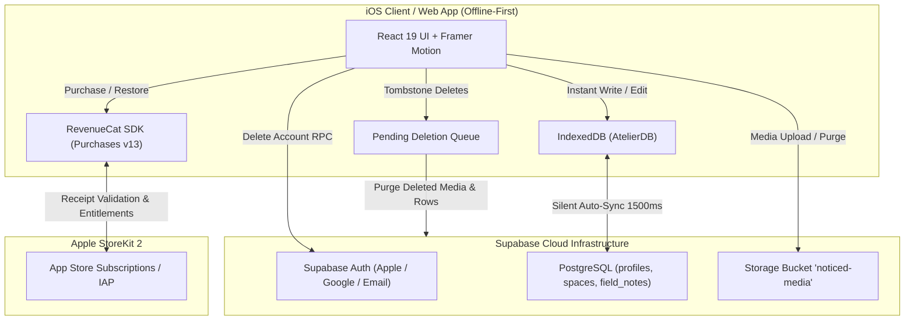

# NOTICED — Technical & Product Whitepaper (v2.0)

> **"for things you don't want to forget"**  
> *A quiet, local-sovereign field notebook & digital atelier engineered with Apple-Style High-Density Liquid Glass, Penguin Classics editorial typography, hybrid Supabase synchronization, and StoreKit 2 / RevenueCat architecture.*

---

## Daftar Isi

1. [Ringkasan Eksekutif & Filosofi Produk](#1-ringkasan-eksekutif--filosofi-produk)
2. [Sistem Desain & Estetika Editorial](#2-sistem-desain--estetika-editorial)
3. [Fitur Utama & Pengalaman Pengguna (UX)](#3-fitur-utama--pengalaman-pengguna-ux)
4. [Arsitektur Data Hybrid & Offline-First Pipeline](#4-arsitektur-data-hybrid--offline-first-pipeline)
5. [Skema Database PostgreSQL, Storage & Hardened RPC](#5-skema-database-postgresql-storage--hardened-rpc)
6. [Rekayasa iOS Native & App Store Compliance](#6-rekayasa-ios-native--app-store-compliance)
7. [Arsitektur Monetisasi & Billing (RevenueCat & StoreKit 2)](#7-arsitektur-monetisasi--billing-revenuecat--storekit-2)
8. [Keamanan, Privasi & Kepatuhan Store (GDPR & Apple 5.1.1(v))](#8-keamanan-privasi--kepatuhan-store-gdpr--apple-511v)
9. [Peta Struktur Direktori & Organisasi Kode](#9-peta-struktur-direktori--organisasi-kode)
10. [Panduan Build, Fastlane & Deployment](#10-panduan-build-fastlane--deployment)

---

## 1. Ringkasan Eksekutif & Filosofi Produk

**Noticed** adalah aplikasi buku catatan lapangan (*field notebook*) dan suaka refleksi editorial yang dirancang untuk mereka yang menghargai keintiman buku catatan fisik, sastra klasik, dan ketenangan berpikir bebas dari distraksi algoritmik.

Noticed memadukan dua disiplin utama:
1. **Keanggunan Buku Cetak Klasik (*Penguin Classics & Moleskine*)**:
   - Tata letak aliran naskah (*manuscript stream*), superskrip catatan kaki marginalia, stabilo berlapis, sampul kain *buckram*, dan motif foil emas/perak/kobalt.
2. **Presisi Antarmuka iOS Modern (*High-Density Liquid Glass*)**:
   - Permukaan kaca buram berdensitas tinggi (*frosted translucent glass*), pantulan spekular tepi dinamis (*specular rim highlights*), transisi pegas fisik (*spring physics*), dan umpan balik taktil mikro (*haptic impulses*).

---

## 2. Sistem Desain & Estetika Editorial

### 2.1. Palet Tema Monokrom Terkurasi (4 Resolusi)
Noticed menerapkan empat tema warna terkurasi yang dikendalikan melalui atribut `data-theme` pada elemen `:root`:

| Tema | Mode | Karakteristik Visual | Background (`--sheet-bg`) | Teks Utama (`--text-primary`) |
| :--- | :--- | :--- | :--- | :--- |
| **Warm Paper** | Light | Kertas linen krem alabaster klasik | `#F7F5F0` | `#1C1917` |
| **Daylight** | Light | Porselen putih bersih bertepi perak | `#FFFFFF` | `#111113` |
| **Obsidian** | Dark | Batu tulis malam monokrom pekat | `#111113` | `#F5F5F4` |
| **Espresso** | Dark | Kulit kayu mahoni & kopi sangrai gelap | `#181412` | `#F4EFEA` |

### 2.2. Tipografi Empat Pilar
Setiap buku catatan (*Space*) dapat menentukan kepribadian tipografinya sendiri:
- **Editorial (`Newsreader`)**: Serif sastra untuk bacaan reflektif dan esai panjang.
- **Classic Display (`Cormorant Garamond`)**: Serif kontras tinggi bergaya majalah seni & jurnal folio.
- **Geometric Sans (`Urbanist`)**: Sans-serif kontemporer yang bersih untuk entri cepat.
- **Metadata & Indeks (`Courier Prime` / `Space Mono`)**: Huruf mesin tik monospaced untuk penanda waktu, tanggal, dan koordinat.

### 2.3. Aturan Ikonografi Ketat (Zero Emoji UI)
Seluruh kontrol antarmuka wajib menggunakan ikon garis vektor dari `lucide-react` (`strokeWidth={1.5}` hingga `2.25`). Penggunaan emoji sistem berwarna pada tombol dan navigasi **dilarang sepenuhnya** demi menjaga keselarasan estetika monokromatis.

---

## 3. Fitur Utama & Pengalaman Pengguna (UX)

### 3.1. Spatial 3D Bookshelf (`BookshelfModal.tsx` & `BookshelfSpine.tsx`)
- **Mode Spines**: Buku-buku berjajar di atas pedestal kayu/kaca dengan tekstur kain *buckram*, pita kapital (*headband*), foil mewah, dan pratinjau punggung buku interaktif.
- **Mode Covers**: Karusel spasial 3D *edge-to-edge* (`perspective: 1400px`) yang menampilkan sampul fisik lengkap.
- **Time-Zone Aware Greeting**: Menyapa pengguna secara dinamis mengikuti waktu setempat (*Good Morning / Afternoon / Evening / Night*) disertai indikator sinkronisasi cloud.

### 3.2. Editorial Manuscript Stream (`NoteEntry.tsx`)
- **Inline Text Highlighter & Marginalia**: Seleksi teks langsung untuk memberi stabilo atau menautkan *marginalia* dengan penomoran superskrip otomatis.
- **Analog Darkroom (Polaroid & Photostrip)**: Lampiran foto berformat bingkai fisik polaroid dengan stempel tanggal mesin tik dan grain film analog.
- **Inline Autoplay Video 30s**: Klip bergerak 30 detik diputar otomatis tanpa suara saat terdeteksi oleh `IntersectionObserver` (`threshold: 0.65`).
- **Tactile Voice Memo**: Perekaman memo suara dengan visualisasi gelombang frekuensi audio (*Web Audio API AnalyserNode*).
- **Zen Reading Mode & Spotlight Search**: Mode baca bebas tombol kontrol dan pencarian instan fuzzy di seluruh ruang catatan.

### 3.3. Bilingual Engine & Habit Reminders
- **i18n Multi-bahasa**: Seluruh antarmuka, pengaturan, pesan kesalahan, dan disclamer storeKit tersedia penuh dalam **Bahasa Indonesia (`id`)** dan **English (`en`)**.
- **Pengingat Menulis Harian**: Didukung `@capacitor/local-notifications` untuk membangun kebiasaan refleksi harian tanpa pelacak pihak ketiga.

---

## 4. Arsitektur Data Hybrid & Offline-First Pipeline

Noticed beroperasi dengan prinsip **Local Sovereignty First**:
Semua catatan, foto, dan audio tersimpan secara instan di dalam IndexedDB (`AtelierDB`). Saat koneksi internet tersedia, sistem menjalankan *Silent Debounced Auto-Sync* (1500ms) ke Supabase.



---

## 5. Skema Database PostgreSQL, Storage & Hardened RPC

### 5.1. Struktur Relasi Utama
- `public.profiles`: Profil penulis, nama tampilan, bio, avatar URL.
- `public.spaces`: Ruang buku catatan, preferensi sampul, font, warna, dan status kolaborasi.
- `public.field_notes`: Catatan lapangan, judul, teks, highlights, marginalia JSONB, foto JSONB, video JSONB, dan memo suara JSONB.

### 5.2. Hardened Account Deletion RPC (`public.delete_user_account()`)
Untuk memenuhi regulasi **Apple App Store Guideline 5.1.1(v)** dan **GDPR**, penghapusan akun dilakukan secara permanen melalui stored procedure PostgreSQL berstatus `security definer`:

```sql
create or replace function public.delete_user_account()
returns void
language plpgsql
security definer set search_path = public, auth, storage
as $$
declare
  v_user_id uuid;
begin
  v_user_id := auth.uid();
  if v_user_id is null then
    raise exception 'Not authenticated';
  end if;

  -- 1. Purge physical storage files belonging to user in 'noticed-media' bucket
  begin
    delete from storage.objects
    where bucket_id = 'noticed-media'
      and (owner = v_user_id or name like '%' || v_user_id::text || '%');
  exception when others then
    null;
  end;

  -- 2. Explicitly clean up all user-owned notes, spaces, and profiles
  delete from public.field_notes where user_id = v_user_id;
  delete from public.spaces where user_id = v_user_id;
  delete from public.profiles where id = v_user_id;

  -- 3. Delete user identity from auth.users (cascades sessions, refresh tokens)
  delete from auth.users where id = v_user_id;
end;
$$;
```

---

## 6. Rekayasa iOS Native & App Store Compliance

- **Framework**: Capacitor 8 dengan konfigurasi `com.syntheticae.noticed`.
- **Target Perangkat**: Terkunci eksklusif untuk iPhone (`TARGETED_DEVICE_FAMILY = "1"`).
- **Dynamic Island Safe Placement**:
  ```css
  top: max(calc(env(safe-area-inset-top, 0px) + 14px), 24px);
  ```
- **Home Indicator Clearance**:
  ```css
  padding-bottom: max(calc(env(safe-area-inset-bottom, 0px) + 14px), 24px);
  ```
- **Store Graphics Kit (`store-assets/`)**:
  - Master App Icon: `1024 × 1024 px` (Format 24bpp RGB, nol channel alpha).
  - Screenshots iOS 6.7" (iPhone 16 Pro Max / 15 Pro Max): `1290 × 2796 px`.
  - Screenshots iOS 6.5" (iPhone 14 Plus / 11 Pro Max): `1242 × 2688 px`.
  - Android Phone Screenshots: `1080 × 2400 px`.

---

## 7. Arsitektur Monetisasi & Billing (RevenueCat & StoreKit 2)

- **SDK**: `@revenuecat/purchases-capacitor` v13.7.4.
- **Kunci Kredensial App Store Connect**:
  - In-App Purchase Key: `VV2BGUYC5N.p8`
  - App Store Connect API Key: `X4SX9VQZ44.p8`
- **Katalog Produk Atelier Pro**:
  1. `noticed_pro_monthly` — Berlangganan bulanan.
  2. `noticed_pro_annual` — Berlangganan tahunan dengan diskon folio.
  3. `noticed_pro_lifetime` — Pembelian satu kali seumur hidup (*Patron*).
- **Aturan Lifetime Validity**:
  - Paket Patron non-subscription secara ketat memaksa `expiresAt = null` dan `willRenew = false` agar tidak menampilkan tanggal kedaluwarsa hari ini pada UI.
- **Pemisahan Modal Antarmuka**:
  - `SubscriptionSuccessModal.tsx`: Menampilkan selebrasi sambutan keanggotaan dan peninjauan hak istimewa Pro (`[✓ Unlocked]`).
  - `ManageSubscriptionModal.tsx`: Menampilkan status masa aktif, tombol pemulihan transaksi (*Restore Purchases*) terintegrasi, dan tombol **Buka Pengaturan Langganan Apple** (`itms-apps://apps.apple.com/account/subscriptions`) untuk pembatalan perpanjangan otomatis sesuai pedoman Apple.

---

## 8. Keamanan, Privasi & Kepatuhan Store (GDPR & Apple 5.1.1(v))

1. **Native Sign in with Apple & Google OAuth**:
   - iOS menggunakan sheet native Face ID / Passcode (`@capacitor-community/apple-sign-in`) tanpa pengalihan ke browser Safari.
   - Google Sign-In menggunakan pertukaran ID Token dengan cryptographic `rawNonce` via `@capawesome/capacitor-google-sign-in`.
2. **Resiliensi Jaringan Handshake IPv6**:
   - Seluruh pemanggilan autentikasi Supabase dibungkus dengan utilitas `withRetryTimeout` (auto-retry 300ms) untuk menangani *SYN packet drop* pada jaringan dual-stack IPv6 ISP rumahan/seluler Indonesia.
3. **Pembersihan Bersih Saat Hapus Akun**:
   - Pemanggilan RPC `delete_user_account` di server.
   - Penghapusan seluruh basis data IndexedDB Atelier.
   - Penghapusan seluruh kunci cache `localStorage` (`noticed_*` dan `sidenotes_*`).
   - Logout identitas RevenueCat (`logoutPurchasesUser()`).

---

## 9. Peta Struktur Direktori & Organisasi Kode

```text
d:\Project\noticed\Noticed-Mobile
├── .env.example
├── capacitor.config.ts          # Konfigurasi iOS Capacitor 8 (com.syntheticae.noticed)
├── GEMINI.md                    # Aturan arsitektur & rekayasa sistem
├── PROJECT_RULES.md             # Invarian estetika & safe-area iOS
├── WHITEPAPER.md                # Dokumen teknis resmi (dokumen ini)
├── store-assets/                # Aset toko resmi (icon 1024x1024, screenshot 6.7" & 6.5")
│   └── STORE_LISTING_METADATA.md
├── supabase/                    # Skrip SQL & migrasi PostgreSQL
│   ├── schema.sql
│   └── migrations/
│       ├── 20261005_add_videos_to_field_notes.sql
│       ├── 20261005_create_storage_bucket.sql
│       └── 20261017_harden_delete_user_account_rpc.sql
└── src/
    ├── App.tsx                  # State root, alur auth, navigasi & sinkronisasi
    ├── index.css                # CSS variables, palet 4-tema & Liquid Glass tokens
    ├── components/
    │   ├── auth/                # Gerbang onboarding, Apple/Google OAuth, verifikasi OTP
    │   │   ├── OnboardingGate.tsx
    │   │   └── InAppOtpVerifyModal.tsx
    │   ├── notes/               # Editor catatan, marginalia, photostrip, video player
    │   │   ├── CreateNoteSheet.tsx
    │   │   ├── NoteEntry.tsx
    │   │   ├── InlineVideoPlayer.tsx
    │   │   ├── PhotostripModal.tsx
    │   │   ├── QuickAnnotatorModal.tsx
    │   │   └── TextHighlighter.tsx
    │   ├── spaces/              # Rak buku spasial 3D, karusel covers, & punggung buku
    │   │   ├── BookshelfModal.tsx
    │   │   └── BookshelfSpine.tsx
    │   └── ui/                  # Modal & sheet berdesain Liquid Glass
    │       ├── AtelierProModal.tsx
    │       ├── SubscriptionSuccessModal.tsx
    │       ├── ManageSubscriptionModal.tsx
    │       ├── ProfileSheet.tsx
    │       ├── SettingsSheet.tsx
    │       └── LegalModal.tsx
    └── lib/                     # Utilitas penyimpanan, media, i18n & billing
        ├── i18n.ts              # Mesin lokalisasi dwibahasa (ID & EN)
        ├── purchases.ts         # RevenueCat & StoreKit 2 bridge
        ├── proManager.ts        # Sinkronisasi status Pro & entitlments
        ├── storage.ts           # Mesin IndexedDB (AtelierDB)
        ├── supabase.ts          # Klien Supabase & resiliensi jaringan
        └── haptics.ts           # Haptik getaran mikro iOS
```

---

## 10. Panduan Build, Fastlane & Deployment

1. **Menjalankan Server Pengembangan**:
   ```powershell
   npm run dev
   ```
2. **Kompilasi TypeScript & Produksi Web**:
   ```powershell
   npm run build
   ```
3. **Sinkronisasi ke Proyek iOS Native**:
   ```powershell
   npx cap sync ios
   ```
4. **Membuka Proyek di Xcode (macOS)**:
   ```powershell
   npx cap open ios
   ```
5. **Otomatisasi Deployment via GitHub Actions / Fastlane**:
   - Alur kerja di `.github/workflows/deploy-appstore.yml` mengotomatisasi pengiriman build langsung ke TestFlight dan App Store Connect.
